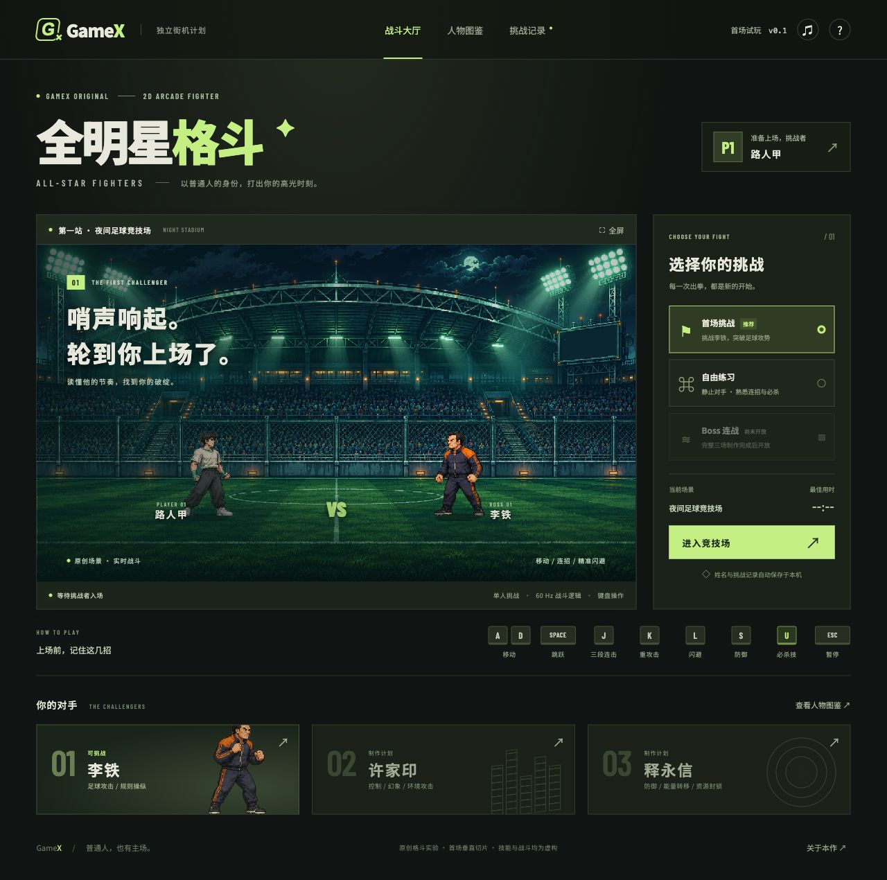

# GameX《全明星格斗》

[GitHub 公有仓库](https://github.com/LeP-Ton/gamex-all-star-fighters)

原创 PC 浏览器 2D 格斗游戏的首场可玩垂直切片：**路人甲 VS 李铁**。

当前可玩内容已落地，但**不是完整三 Boss 游戏，也尚未达到《死神 VS 火影》成熟版本的动画品质**。按照任务书的顺序，先完善首场动画与手感，再制作后续两名 Boss。详细边界见 [质量差距](docs/QUALITY_GAPS.md)。



## 本地运行

需要 Node.js 20.19+（本次验证为 20.20.2）。

```sh
git clone https://github.com/LeP-Ton/gamex-all-star-fighters.git
cd gamex-all-star-fighters
npm ci
npm run dev
```

打开终端显示的本机地址，默认 `http://127.0.0.1:5173/`。本次已安装依赖，当前机器可直接运行 `npm run dev`。不要直接双击 `index.html`，资源加载需要 HTTP 服务。

```sh
npm test         # 独立战斗逻辑、动画选帧与存档测试
npm run build    # 类型检查与生产构建，产物在 dist/
npm run preview  # 预览生产构建，默认端口 4173
```

项目级 `.npmrc` 与锁文件使用公开 npm 源，依赖版本和完整性校验已锁定，克隆后通过 `npm ci` 安装。没有修改全局 npm 配置。

## 可玩内容

- 首场挑战：李铁具有任意球、可拦截红包、位置预警突袭与三段强化球。
- 自由练习：静止对手、初始满能量、无超时失败，可调招式数据和触发技能。
- 独立 60 Hz 战斗：三段普通攻击、重击、空中攻击、防御、闪避、精准闪避、必杀、输入缓冲、命中停顿、击退和倒地起身。
- 大厅、角色命名、图鉴、统一 HUD、暂停、结算、最近 30 场记录与正式首场最佳成绩。
- 两套各 24 格的原创 AI 人物图集、原创球场背景、12 个程序合成音效与程序特效。

自由练习不等同于通关后自由 Boss 挑战，不写入正式最佳成绩，也不解锁完整游戏。许家印、释永信、完整闯关和 Boss 连战明确保留为待开发状态。

## 操作

| 操作 | 按键 |
|---|---|
| 移动 | A / D |
| 跳跃 | Space |
| 三段普通攻击 | 连续点按 J |
| 重攻击 | K |
| 防御 | 按住 S |
| 闪避 | L |
| 必杀（100 能量） | U |
| 暂停 / 恢复 | Esc |

命中攻击和精准闪避积累能量。动作按键按下时触发，长按不会自动连发。界面失去焦点时自动暂停并清除持续输入。防御仍会少量扣血，因此无伤按满血判定，不只看受击次数。

首次进入战斗可以命名，右上角玩家卡片可再次修改。姓名、声音与战绩保存在当前来源下的 LocalStorage，键为 `gamex-all-star-fighters:v1`；不同浏览器、域名或端口的存档互不共享。禁用存储时仍可游玩，但刷新后不会保留本次数据。

## 调试

战斗右侧“判定框调试”显示攻击框（红）、受击框（绿）、身体框（蓝）、状态帧与即时 FPS。自由练习中还会出现页面下方的调参面板：选择招式，修改起手、有效、收招、伤害或范围，点击“应用本场参数”。只影响本次战斗；重开会恢复源数据。

正式挑战可查看判定框，但不开放调参，防止修改后的战绩混入正式记录。练习面板可分别触发李铁的四种技能，适合观察预警与反制。

## 验证与限制

本次自动化与浏览器实际验证见 [验证记录](docs/qa/VALIDATION.md)。桌面浏览器已实际操作命名、移动、攻击、必杀、暂停恢复、调参、练习结算和记录刷新。390px 窄屏布局无横向溢出，但**没有触屏战斗操作**，当前需要键盘。

战斗设为 60 Hz，渲染目标为 60 FPS；尚未做持续性能采样、Safari/Firefox 兼容矩阵及录像逐帧对标，不据此宣称稳定 60 FPS。音效由 Phaser 加载，首次交互后播放。网页字体可选从 Google Fonts 加载，离线时使用系统字体；人物、场景、音效与战斗均在本地，无游戏服务器和网络 AI。

## 工程与资源入口

- [参考工程技术分析](docs/REFERENCE_ANALYSIS.md)：实际源码研究、许可证与独立实现原则。
- [架构和角色扩展](docs/ARCHITECTURE.md)：核心、渲染、技能、存档与后续抽象边界。
- [美术生产记录](docs/art/PRODUCTION.md)与[生成提示词](docs/art/prompts.json)：内置 imagegen 原创制作、真实尺寸及动作映射。
- [剩余质量问题](docs/QUALITY_GAPS.md)：逐帧校正、扩帧、镜头、场景与完整游戏缺项。
- [需求入口](.agentdocs/workflow/REQ-20261104135500-首场格斗垂直切片/README.md)：需求范围、验收状态和阶段变更。

仅研究 5DPLAY 公开工程的通用原理；未复制其 ActionScript、动漫角色、美术、特效或音频。游戏人物图鉴将已确认事实与虚构技能分别说明。
